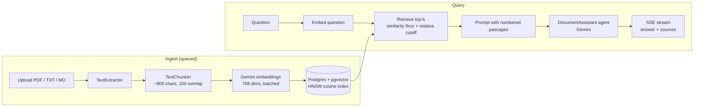

# DocChat — RAG with Laravel 13

[](https://github.com/rajarizwan2007/ai_rag_chat_laravel/actions/workflows/tests.yml)

Ask questions about your own documents. DocChat is a retrieval-augmented generation (RAG) app built with **Laravel 13**, **PostgreSQL + pgvector** and the **Laravel AI SDK** (Gemini).

Upload a PDF, TXT or Markdown file, then ask a question. The answer is grounded in your documents, cites the passages it used, and streams in as it is generated. If the documents don't contain the answer, it says so instead of guessing.

## Architecture



| Piece | Where |
|---|---|
| Text extraction (PDF via `smalot/pdfparser`) | [`app/Services/TextExtractor.php`](app/Services/TextExtractor.php) |
| Chunking | [`app/Services/TextChunker.php`](app/Services/TextChunker.php) |
| Embedding job | [`app/Jobs/ProcessDocument.php`](app/Jobs/ProcessDocument.php) |
| Retrieval + prompt building | [`app/Services/RagService.php`](app/Services/RagService.php) |
| Answering agent and its rules | [`app/Ai/Agents/DocumentAssistant.php`](app/Ai/Agents/DocumentAssistant.php) |
| Streaming over Server-Sent Events | [`app/Http/Controllers/ChatController.php`](app/Http/Controllers/ChatController.php), [`resources/js/chat.js`](resources/js/chat.js) |
| Tuning knobs | [`config/rag.php`](config/rag.php) |

## Design decisions

**pgvector instead of a separate vector database.** Documents, chunks and vectors live in one Postgres database, so there is one thing to run, back up and keep consistent. Laravel 13's `vector` column, `AsVector` cast and `whereVectorSimilarTo()` make it first-class in Eloquent. An HNSW index keeps nearest-neighbour search fast as the table grows.

**768-dimension embeddings.** Gemini returns 3072 dimensions by default, but pgvector's HNSW index supports up to 2000. Gemini embeddings are trained so they can be shortened, so 768 keeps most of the quality with a quarter of the storage.

**Chunking with overlap.** Text is split at paragraph, then sentence, boundaries into ~800 character chunks, and the last ~100 characters of each chunk are repeated at the start of the next. Small chunks keep retrieval precise, and the overlap keeps a sentence that crosses a boundary findable.

**Two relevance filters.** I measured similarity scores and found that unrelated chunks still score about 0.5–0.6 with Gemini embeddings, while real matches score 0.64–0.79. A fixed floor alone can't separate them, so retrieval keeps chunks above a floor (0.55) **and** within 0.06 of the best match. When nothing passes, the model isn't called at all: this saves tokens and avoids made-up answers.

**Grounded prompt with citations.** Retrieved chunks are numbered in the prompt and the agent's instructions require it to answer only from them, cite `[n]`, and reply "I couldn't find that in your documents." otherwise.

**Ingestion on a queue.** Extracting and embedding a large PDF can take a while and the embeddings API can rate-limit, so it runs in a queued job with retries and back-off. Chunks are replaced inside a transaction, so a retry never leaves duplicates.

**Streaming.** Answers stream over Server-Sent Events (sent with `fetch`, since `EventSource` only supports GET). The page still works as a normal form post without JavaScript.

**Testable without an API key.** Tests use the AI SDK's fakes with deterministic "topic" vectors, so retrieval, filtering, prompt building and streaming are all tested against a real pgvector database in CI.

## What I'd add next

- Hybrid search (Postgres full-text + vectors) for exact terms like product codes
- A reranking step on the top 20 candidates
- An evaluation set of questions with expected sources, to measure changes to chunking and thresholds
- Conversation memory for follow-up questions
- Authentication, so each user only sees their own documents

## Stack

Laravel 13 · PHP 8.5 · PostgreSQL 18 + pgvector · Laravel AI SDK · Gemini · Laravel Sail (Docker) · Tailwind CSS 4 · PHPUnit · GitHub Actions

## Running locally

Requires Docker (on Windows, run from WSL2).

```bash
git clone https://github.com/rajarizwan2007/ai_rag_chat_laravel.git docchat
cd docchat
cp .env.example .env            # then set GEMINI_API_KEY
docker run --rm -v "$(pwd)":/opt -w /opt laravelsail/php84-composer:latest composer install --ignore-platform-reqs
./vendor/bin/sail up -d
./vendor/bin/sail artisan key:generate
./vendor/bin/sail artisan migrate
./vendor/bin/sail npm install && ./vendor/bin/sail npm run build
```

Open http://localhost. A `queue` container processes uploads in the background.

Get a free Gemini API key at https://aistudio.google.com/apikey.

## Tests

```bash
./vendor/bin/sail artisan test
```
